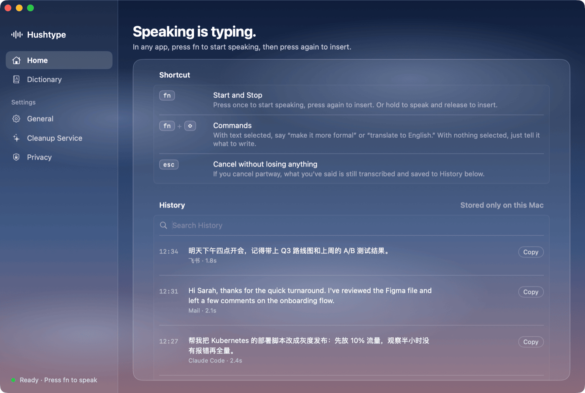

# Hushtype

**English** · [简体中文](README.zh-CN.md)

Native macOS voice typing: press fn, speak, and cleaned-up text appears at the cursor in any app.

<p align="center"></p>

- **Small** — ~26 MB download, native Swift, no Electron.
- **Light** — ~600 MB with all models loaded, ~118 MB once they unload when idle. No GPU.
- **Private** — speech recognition runs on your Mac (SenseVoice + Whisper); audio is never uploaded.
- **Smart, optional** — an LLM removes filler words, fixes self-corrections and punctuation: Claude Sonnet 5.5 by default, or your own key for DeepSeek, Zhipu GLM, Kimi, Qwen, Doubao, OpenAI or any OpenAI-compatible endpoint. Or stay fully offline.
- **Tidy** — history and recordings clean themselves up (recordings: 7 days / 500 MB by default).

## Watch the 1-minute tour

https://github.com/user-attachments/assets/81bb0812-c487-41d5-b6fe-5c47b43fbe8c

## Install

Download the DMG from [Releases](https://github.com/panoslin/hushtype/releases) and drag Hushtype to Applications. It isn't notarized yet: on first launch, go to **System Settings › Privacy & Security › Open Anyway**. Requires macOS 14+ on Apple silicon.

## Use

- **fn**, speak, **fn** — insert text (or hold fn while talking)
- **fn + ⇧** — speak an instruction for the selected text
- **Esc** — cancel (still saved to History)

## Build

```bash
Scripts/build_app.sh && Scripts/test.sh && Scripts/package_dmg.sh
```

`QA=1 Scripts/build_app.sh` builds a test copy in `.build/qa-app/` that accepts the QA launch arguments; the release app ignores them.

## License

[PolyForm Noncommercial 1.0.0](LICENSE.md) — free for non-commercial use. For commercial use, [open an issue](https://github.com/panoslin/hushtype/issues).
