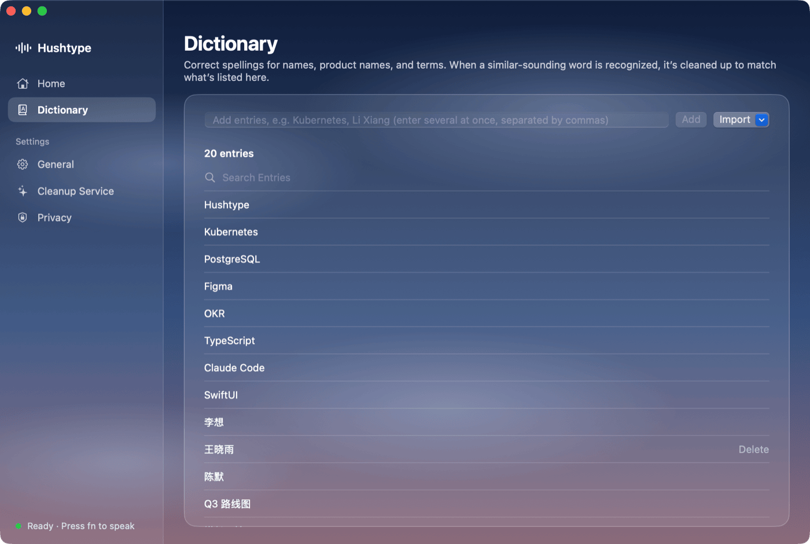
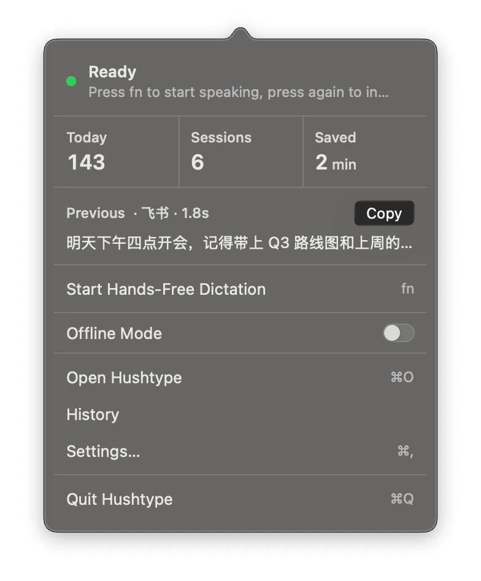
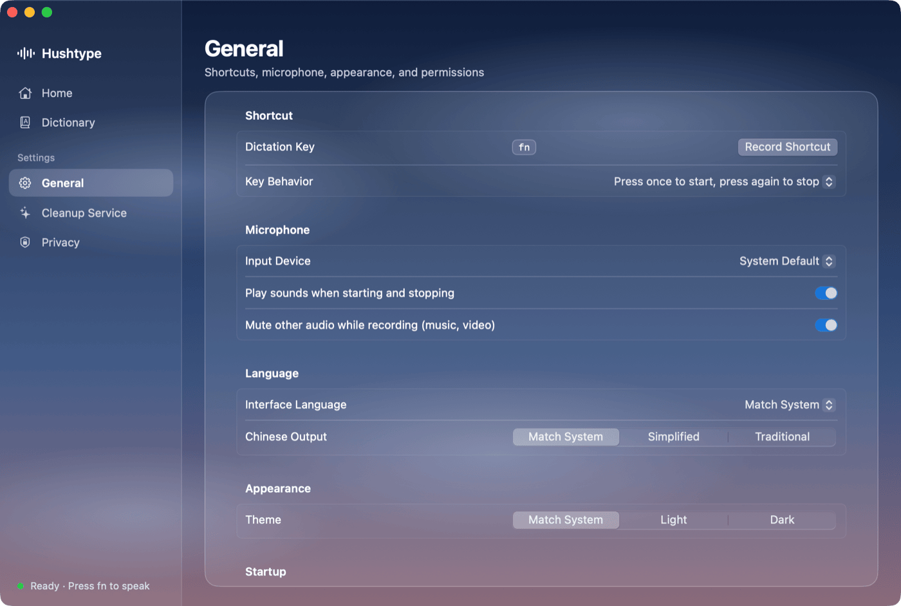

# Hushtype

**English** · [简体中文](README.zh-CN.md)

A native macOS voice keyboard. Press a key, speak, and cleaned-up text is typed at the cursor in any app.

<p align="center"></p>

<p align="center"></p>

## Why Hushtype

| | |
|---|---|
| 🪶 **Small** | ~26 MB download, ~76 MB app. Written in native Swift (AppKit/SwiftUI): no bundled browser engine, no Electron. Speech models (~850 MB, pinned versions, SHA-256 verified) download on first use. |
| 🧠 **Light on memory** | ~600 MB with every model loaded (app 118 MB + recognition engine 480 MB) — still less than the ~675 MB a comparable Electron dictation app uses without running any model locally. Models unload after 30 idle minutes or under memory pressure, leaving ~118 MB. 0% CPU when idle, never uses the GPU. |
| 🔒 **Recognition stays on your Mac** | SenseVoice (sherpa-onnx) and Whisper large-v3-turbo (WhisperKit, on the Neural Engine) run side by side on device. Recordings are never uploaded, and not kept by default. |
| ✨ **Optional AI cleanup** | The transcript can be polished by Claude Sonnet 5.5: filler words removed, self-corrections resolved, punctuation and formatting added, names and terms spelled right from context. Only text is sent, never audio — or turn it off and stay fully offline. |

<sub>Memory measured on the author's Apple silicon Mac (Oct 2026); varies with models and system.</sub>

## Screens

| Dictionary | Menu bar |
|---|---|
|  |  |

| General settings | Cleaning up |
|---|---|
|  |  |

## Install

1. Download `Hushtype-<version>.dmg` from [Releases](https://github.com/panoslin/hushtype/releases) and drag Hushtype into Applications.
2. The app isn't notarized by Apple yet, so macOS blocks the first launch: open **System Settings › Privacy & Security** and click **Open Anyway**.
3. Grant microphone and Accessibility access when asked, and let the speech models download.

Requires macOS 14+ on Apple silicon.

## Use

| Action | Result |
|---|---|
| Press fn (or right ⌥ / right ⌘ / right ⌃), speak, press again | Inserts the cleaned-up text |
| Hold fn while speaking, release | Same (push to talk) |
| Select text, press fn+⇧ and say an instruction | Rewrites the selection; with nothing selected, writes what you asked for |
| Esc while speaking | Cancel (what you said is still saved to History) |
| Menu bar › Copy last | Fallback when insertion fails |

## Cleanup service

Three options, switchable in Settings:
1. **Your own Anthropic API key** — stored in the Keychain, calls api.anthropic.com directly.
2. **Hushtype Cloud / self-hosted proxy** — no key needed on the Mac; see `server/README.md`.
3. **Offline** — no cleanup; inserts the on-device transcript.

## Build

Needs macOS 14+, Apple silicon and Swift 6 (Command Line Tools are enough; Xcode isn't required).

```bash
Scripts/build_app.sh          # → dist/Hushtype.app
Scripts/test.sh               # unit tests
Scripts/package_dmg.sh        # → dist/Hushtype-<version>.dmg
```

Signing: set `HUSHTYPE_SIGN_IDENTITY="Developer ID Application: …"` before building, then run `Scripts/notarize.sh`. Without a Developer ID the build uses a local "Hushtype Local Dev" self-signed certificate (permissions survive rebuilds), or ad-hoc signing.

## Layout

```
Sources/HushtypeCore/   engine (no UI; embeddable)
  ASR/                SenseVoice (sherpa-onnx C API), WhisperKit
  Rewrite/            prompts, Claude client, output guards
  Engine/             recognition + cleanup pipeline; on-demand model loading
  System/             Accessibility: read cursor context, insert text
  Storage/            settings, Keychain, local history (SQLite)
  Models/             model download (pinned + SHA-256)
  Audio/              mic capture, muting other apps while dictating
Sources/Hushtype/       menu bar app: hotkey, HUD, onboarding, settings
Sources/hushtype-cli/   developer tool: transcribe / eval / install-models
server/               Hushtype Cloud reference (Cloudflare Worker proxy)
docs/                 privacy notes, screenshots
```

## Third-party components

- [sherpa-onnx](https://github.com/k2-fsa/sherpa-onnx) (Apache-2.0) and the SenseVoice model
- [WhisperKit](https://github.com/argmaxinc/WhisperKit) (MIT) and whisperkit-coreml models
- Their licenses ship inside the app under `Contents/Resources/Licenses/`.

## License

[PolyForm Noncommercial 1.0.0](LICENSE.md): free for personal, educational, research and nonprofit use; you may read, modify and share the source. **Commercial use needs a separate license** — get in touch via [Issues](https://github.com/panoslin/hushtype/issues). Third-party components and models keep their own licenses.
