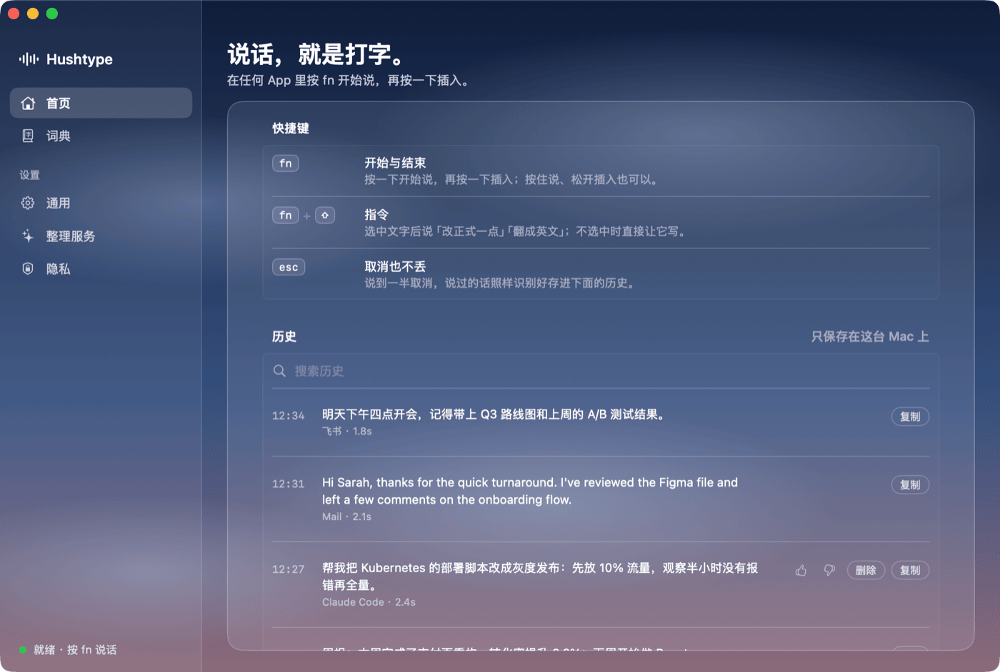

# Hushtype

[English](README.md) · **简体中文**

原生 macOS 语音输入：按 fn 说话，整理好的文字直接出现在任何 App 的光标处。

<p align="center"></p>

- **小**：安装包约 26 MB，原生 Swift，没有 Electron。
- **省**：模型全部加载约 600 MB，闲置释放后约 118 MB；不占 GPU。
- **私密**：语音识别在本机完成（SenseVoice + Whisper），录音不上传。
- **可选智能整理**：用大模型去口头禅、处理改口、加标点。默认 Claude Sonnet 5.5，也可以填自己的 key 用 DeepSeek、智谱 GLM、Kimi、通义千问、豆包、OpenAI 或任意 OpenAI 兼容接口；也可以完全离线。
- **自动清理**：历史和录音会自动清理（录音默认保留 7 天、最多 500 MB）。

## 一分钟使用教程

https://github.com/user-attachments/assets/d9c41e97-f004-4f79-9a13-58a56eda606b

## 安装

从 [Releases](https://github.com/panoslin/hushtype/releases) 下载 DMG，把 Hushtype 拖进「应用程序」。目前还没有经过 Apple 公证，第一次打开时到「系统设置 › 隐私与安全性」点「仍要打开」。需要 macOS 14+、Apple 芯片。

## 使用

- **fn**，说话，**fn**：插入文字（也可以按住 fn 说）
- **fn + ⇧**：对选中的文字说指令
- **Esc**：取消（仍会存进历史）

## 构建

```bash
Scripts/build_app.sh && Scripts/test.sh && Scripts/package_dmg.sh
```

## 许可证

[PolyForm Noncommercial 1.0.0](LICENSE.md)：非商业用途免费；商业使用请[提 Issue](https://github.com/panoslin/hushtype/issues) 联系。
